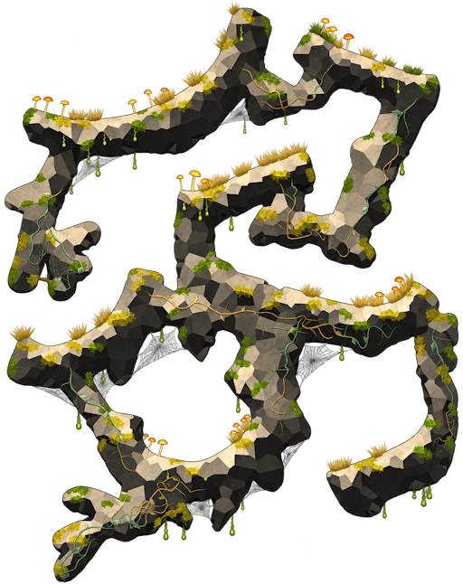

# ebiten-infinicave



An infinite, seed-driven cavern for Go games built with [Ebitengine](https://ebitengine.org/). Explore upward or rightward through faceted rock, branching ledges, vines, mushrooms, moss, grass, cave bulbs, lichen, and spider webs.

The root package gives you a streamed `Scene` that fits into your own Ebitengine game loop. You control the camera, input, window, and UI. A standalone viewer is included for exploring and exporting scenes.

## Install

Requires Go 1.27+. A graphical session is needed to run the viewer or an Ebitengine game using the library.

```sh
go get github.com/razzie/ebiten-infinicave
```

## Quick Start

Create a scene once, then update and draw it from your `ebiten.Game`. Scene methods belong on the game goroutine.

```go
config := infinicave.DefaultConfig()
config.Seed = 42

scene, err := infinicave.NewScene(config)
if err != nil {
    return err
}
defer scene.Close()

// In Update:
viewport := infinicave.Viewport{Y: -1, Height: 1}
ready := scene.Update(viewport)
_ = ready // false while the visible terrain is loading

// In Draw:
scene.Draw(screen, viewport)
```

The viewport and all world coordinates use scene units. A section is one unit square; vertical scenes grow toward negative Y from the floor at zero. For horizontal scrolling, set `config.Orientation = infinicave.Horizontal` before creating the scene.

## Explore

Run the interactive viewer:

```sh
go run ./cmd/infinicave -seed 42
```

Use `-mode landscape` to scroll horizontally. Add `-fog-mouse` to steer fog
toward the mouse pointer from screen center; the center stops it and moving
farther away increases its speed. Export a PNG without opening the viewer:

```sh
go run ./cmd/infinicave -seed 42 -output scene.png
```

The viewer also supports diagnostic views, terrain carving, and settings for generation and rendering. Run `go run ./cmd/infinicave -h` to see all flags.

## Learn More

- [Library usage](docs/usage.md): scene lifecycle, coordinates, rendering hooks, configuration, authored terrain, queries, collision, carving, and generation.
- [Architecture](docs/architecture.md): package ownership, code navigation, and generation/rendering lifecycle.
- [License](LICENSE)
