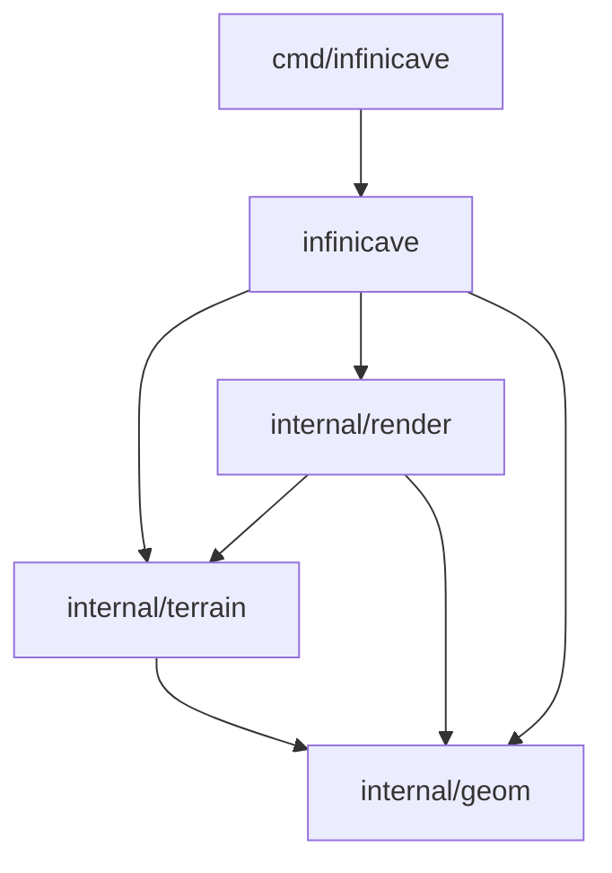

# Code navigation

Import `github.com/razzie/ebiten-infinicave` to use the library. The root package
owns the public API and coordinates generation, rendering, queries, and edits.
Implementation packages live under `internal/`, so applications cannot import
them directly.

| Area | Start here | Responsibility |
| --- | --- | --- |
| Configuration and scene lifecycle | `config.go`, `scene.go` | Validate settings; create, update, reset, draw, and close scenes |
| Public geometry | `geometry.go`, `section.go`, `collision.go`, `orientation.go`, `carve.go` | Expose types and entry points with the existing import path |
| Streaming | `world.go`, `world_stream.go` | Request sections, retain CPU results, publish terrain, budget GPU uploads, and evict distant sections |
| World composition | `render_passes.go`, `world_render.go`, `carve_render.go` | Expose custom drawing hooks, draw cached layers, and refresh images after edits |
| Queries and identity | `query.go`, `query_index.go` | Track loaded coverage, formation and guide IDs, aliases, and revisions |
| Geometry algorithms | `internal/geom/` | Vectors, polygon clipping and triangulation, and ray/segment intersections |
| Terrain and vegetation | `internal/terrain/` | Deterministic section generation, guides, Voronoi rock, lighting, vines, mushrooms, collision topology, and geometry edits |
| Meshes and effects | `internal/render/` | Prepare meshes, scale raster coordinates, batch draws, render effects, and manage their GPU resources |
| Viewer | `cmd/infinicave/` | Parse flags, manage the camera and input, draw UI and hover effects, and export PNGs |

## Dependencies

`geom` and `terrain` have no Ebitengine dependency. Terrain retains the colors,
heights, normals, and topology needed to prepare render meshes. `render` consumes
that data and rendering settings; it never imports the root package or reaches
into a Scene. The background pass receives a narrow drawing interface for the
current cached terrain and foreground silhouette.

Generation and geometry edits stay together because rocks, guides, and plants
share topology and placement rules. Cross-section identity, availability, and
persistent runtime cuts belong to the root, where the world cache is owned.

`Config.RetainSections` controls symmetric retention of loaded sections around
the viewport, while `Config.LookaheadSections` controls extra directional
prefetching beyond the required immediate neighbors. Both counts follow the
scrolling axis in either orientation; retention does not request generation.
When lookahead is enabled, immediate neighbors and directional lookahead also
upload complete GPU layers before becoming visible. Visible layers take priority,
followed by the nearest offscreen sections, within the shared upload budget.

## Ownership and execution

The section worker owns its builder, random streams, guide cache, retained branch paths, and generation timings. It publishes immutable foreground geometry before generating
vegetation or preparing meshes. Foreground-only appearance and a rock-base mesh
then publish without background generation or growth atlas uploads. Background
material retains the compatibility data used by decoration placement. Growth
preparation reuses the base's structural triangles and attachments, fitting only
the later vegetation. It publishes hanging underlay and surface growth images
independently, without replacing the displayed rock base or structural trim.
`Scene.Readiness` exposes the independent layer states. The game goroutine receives that early geometry
and invokes the collision callback. Final vegetation is attached to a separate
geometry value so it cannot mutate already published data.

Mesh preparation uses CPU data, even though vertices use Ebitengine types. GPU
images and shaders are created, uploaded, drawn, resized, and released on the game
goroutine. Upload budgets and cache publication live in `world_stream.go`.
Runnable sections rotate after bounded upload quanta and share draw, index,
pixel-work, and submission-time budgets. Foreground rocks, background rocks,
grass, vegetation, hanging underlay, and surface growth rotate independently
within each section. Background and
grass each retain their own cursor and AA surface, so neither waits for the
foreground image to finish. `terrain_upload.go` and `grass_upload.go` own those
publication paths. Starting or publishing an upload does
not require an extra update. `vegetation_upload.go` owns independent cursors,
images, widths, and reveal clocks for background vines, foreground vines,
mushrooms, and webs. These products can advance alongside terrain uploads and
publish individually as soon as their raster work completes.

`Builder.DecorateProducts` emits immutable per-kind snapshots, including empty
results, without waiting for sibling generators. Each callback prepares and
sends its own mesh. Foreground growth fits from the early appearance alongside
background material/mesh preparation; it does not wait for compatibility
material or decoration generation. The final combined envelope closes the
section job; it is not a publication barrier. Product masks preserve unrelated geometry and meshes, and
recipe identities prevent the final envelope from uploading the same images
again. Newly available products can join an active or parked section upload
without resetting its other cursors. Vegetation readiness waits for all four
plant products at the requested width; `Readiness.Decorations` also includes
growth and grass.

Worker envelopes carry a world epoch and request incarnation. The coordinator
checks both before merging meshes, acknowledging cancellation, or publishing
collision geometry. A late reply cannot finish a newer request for the same
section. Completed request identities remain through retention so unread
collision events can still publish, then expire with eviction; reset creates a
new epoch. Cancellation releases private raster work while retaining published
siblings, their recipes, collision coverage, and reveal clocks. Revisiting an
incomplete section retries its missing products with those images still visible.
Request identities belong to the root coordinator; render recipes remain
independent of request lifetime and raster width. Close drains buffered CPU
replies immediately, and the dispatcher drains again after canceled producers
exit, releasing late replies without blocking the game goroutine on a loader.
Cached refreshes are attempted at most once per section per update; incomplete
recipes cannot request replacement images for missing sibling inputs.

The section phase scheduler and shared helper budget remain. The larger
dependency-graph and progressive-tile changes remain planned in
[render-product-scheduling-design.md](render-product-scheduling-design.md).
`Config.Antialiasing` is fixed for a scene: Full uses geometry antialiasing and
supersampled face uploads; Off and FXAA use native non-antialiased layers and
atlas pages, including carving replay. FXAA owns a reusable final-size target
and filters the scene once after custom passes, grass, bats, and orientation
mapping. CPU geometry and recipes are independent of that raster policy.
Carving replaces connected outer/inner loops independently of material facets.
Finished foreground rock/vine images receive cut masks; background rock and
background vines remain intact. Removed attachments and overlapping
edits replay only dirty image tiles, independently for each layer. Adjacent dirty
tiles are coalesced into rectangles without filling gaps; surviving growth and
wall recipes are batched in their original texture and blend order for replay.
Vine paths,
leaves and material distances remain immutable; carving never splits their CPU
geometry. Moss and ordinary rock walls use texture erasure without support checks.
Compact commands are selected by section
range and replayed before publication. Resizing reuses immutable bake recipes.
Structural faces retain compact guide support identities through carving and
splits. Destroying the last complete support retires the guide across cached
geometry and queries. Immutable retirement snapshots accompany generation jobs;
builders omit those sources before branch generation and release their resolved
guide cache entries. Late results are filtered again before publication.

Shared CPU atlas samples contain 8×8 grass, moss, and hanging-growth variants,
and paired 16×16 mushroom stem/cap pages. Workers transform and batch the sample
meshes into page coordinates; each world incrementally uploads bounded GPU
pages on the game goroutine. Section recipes retain stable
attachment IDs, inset rock support anchors, visual bounds, and dead flags.
Immutable support indexes contain individual anchors and share detection for
paired grass and tooth records. Filtering returns newly dead records for dirty
tiles and upload liveness, without repeating hit detection or rescaling meshes.
The terrain support query returns mushroom/web IDs directly to image editing;
its index and original objects remain unchanged across deletions. Separate visual
bounds select nearby surviving recipes in their original drawing order.
Finished mushroom groups and web networks are removed only when a support is
cut, without cap, stem or silk intersection checks or regeneration.
Foreground vines use the generated branch graph to guide connected cell-edge
routes; forks attach at facet junctions. Background routes branch twice and use
sparse seam graphs near their seeded paths. Background paths precede
their supporting material. Scene builders allocate no dense vine fields.

`Scene.DrawWithPasses` inserts optional drawing after fog (`BehindRocks`) and
after foreground rocks, mushrooms, webs, and foreground vines (`AboveRocks`).
All grass ground patches and blades follow that second hook; bats draw last.
`Draw` delegates with empty hooks. Pass callbacks receive a transform from public
world coordinates into the current target, including the intermediate rotated
target used by horizontal scenes. Hooks run once on the game goroutine and are
excluded from offscreen background and shadow composition.

Grass has its own image, with clipped vector ground patches aligned to cell
normals and atlas blades rooted along the surface but angled toward world-up.
It shares the immutable foreground CPU recipe and supplies the shadow silhouette
alongside rocks, while retaining an independent upload, publication, resize
width, displayed recipe, and reveal clock. A late full foreground recipe can
supply grass while the early rock base is still uploading. Rock publication
preserves already-published grass. Grass edits replay from its own displayed
recipe and width; removing a staged grass attachment restarts only that private
grass upload. `Readiness.Decorations` includes visible grass. Mushrooms and webs use cropped
images published independently from other vegetation. During resize each image
keeps its own displayed width until its replacement finishes; aggregate readiness
waits for all required replacements. Displayed rock and plant recipes retain their
own physical snapshots separately from newer CPU recipes. Carving replays each displayed image from the recipe
that supplied its pixels, including old-width plants during replacement uploads.
Early decoration publication cannot change rock replay or growth transitions.
Carving updates already-published products
even while sibling images or supporting rock images are still uploading.
The viewer's optional `ribbon.go`
trail demonstrates both hooks with mouse input and world coordinates,
advancing its samples during `Game.Update`.

Optional decoration burn dissolves capture cropped removed growth recipes and
foreground vine pixels during runtime carving. `internal/render` owns their
shader, animation, and temporary images; the root coordinates capture and draws
remnants on the original side of `AboveRocks`. Cached images and geometry change
immediately. Snapshots expire during `Update` and are released on reset or close;
stored cuts, loading, and upload replay never start animations.

Material shaders reconstruct canonical artwork coordinates from raster sample
centers. Scaling, cropping, and supersampling preserve that frame, including
carved rims, so replay keeps grain aligned at crop boundaries.

Foreground composition preserves hanging growth → structural underlay and
faces/outlines → surface growth → structural top trim and cut rims. Structural
trim publishes with rocks; growth products keep their own images, recipes,
widths, and reveal clocks. Each product accepts edits at its displayed width,
and overlapping cuts replay only its affected tiles. Support removal restarts
only the affected private growth upload. Burns capture the product's published
pixels and reveal progress. Grass remains above `AboveRocks`.

Optional appearance fades blend in each cached rock or vegetation layer as it
publishes. The root advances independent clocks in `Update`; ordinary drawing
and shadow composition share them. Growth never replaces rocks or restarts their
reveal. During a structural reveal, one reusable scratch image composes the
ordered foreground span before applying structural opacity, preserving uniform
fading where structural layers overlap. Fully revealed rocks draw the cached
spans directly. Crossing plants respect their supporting band's reveal. Resize
retains old-width products until replacements publish and does not restart
reveals. Eviction, reset, and close release the span images and scratch image.
Readiness describes published resources independently of animation progress.

Synchronous generation uses `terrain.GenerationOptions`, populated by the public
`GenerateSectionWithConfig` entry point after validating the full configuration.
Its collision callback runs on the calling goroutine.

## Tests and public compatibility

Tests live in the package that owns the behavior and use the corresponding
source filename (`coordinates.go` / `coordinates_test.go`, for example).
Files that cover several owners are split between those owners.

Scene configuration and effect lifecycle tests belong in root `scene_test.go`,
including fog, background, and bat enablement, updates, reset, and close.
Independent effect and mesh behavior belongs in `internal/render/`. Streaming
and GPU upload integration tests belong in root `world_test.go` and
`world_stream_test.go`; public section generation belongs in `section_test.go`.
Terrain generation, caching, and geometry tests live beside their implementations
in `internal/terrain/`.

External API tests in `api_test.go` exercise the public import path. Shared fixture
helpers stay within their test package and use an area prefix so editor tabs are
easy to distinguish: root `scene_fixtures_test.go`,
`internal/render/render_fixtures_test.go`, and
`internal/terrain/terrain_fixtures_test.go`. Benchmarks use the owner's test file
or an owner-prefixed `*_bench_test.go` file. These API, fixture, and benchmark
files are the exceptions to matching source filenames.

Public geometry types are aliases to their implementation types. Exported names,
fields, methods, constants, and function signatures are preserved. Aliases do
change the defining package reported by reflection for moved types; code relying
on `reflect.Type.PkgPath()` or `%T` should account for that. Internal geometry
helpers are package functions so they do not become methods on aliased public
types.

Run `go test ./...` and `go vet ./...`. CPU geometry tests can also run separately
with `go test ./internal/geom ./internal/terrain`. Rendering and scene checks may
need a graphical environment. Fixed-seed exports in both orientations and the
existing generation/carving benchmarks provide behavior and cost comparisons.
