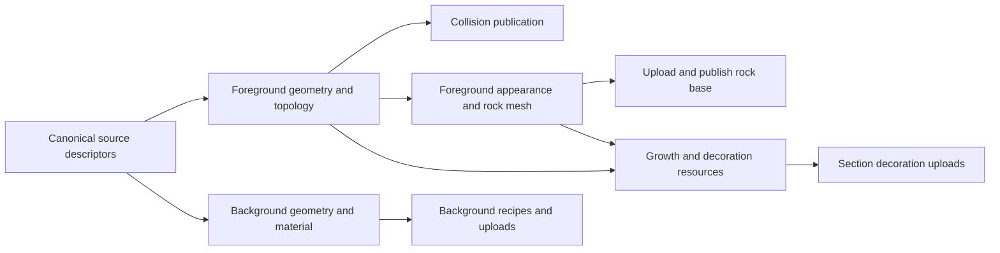

Proposed design: shared world resources and section-owned rendering

This is an implementation plan, not a description of the current system.
The first implementation stage now provides independent foreground appearance,
rock-base publication before background/growth, layer readiness, and the three
antialiasing modes. Late growth currently replaces the complete foreground
image; independent growth layers will follow with shared resource ownership.
The resource registry, cross-section deletion fan-out, canonical terrain patches,
and dependency scheduler below remain planned.
“Section” below means the segment in the request and retains the existing public
API terminology. The change separates the identity and generation of world
objects from the sections responsible for displaying them.

The central rule is: generate a logical resource once while it is resident,
reference it from every section it intersects, and let each section draw only
the pixels inside its own band. A resource's source section determines its
deterministic identity; it does not have to be loaded or rendered for another
section to use that resource.

**Ownership.** Keep the existing internal section frame in both orientations.
For internal index `s`, its drawing band is
`[SectionTop(s), SectionTop(s)+SectionHeight)` along internal Y. These bands
partition the world without overlapping interiors. Background layers keep their
wider cross-axis extent; only their scrolling-axis ownership is partitioned.
Rotate the completed composition for horizontal scenes as today.

The following invariants apply to rocks, growth, mushrooms, webs, and vines:

- A resource has one stable identity and one immutable base definition.
- All sections whose bands intersect its visual bounds hold references to it.
  A resource can intersect more than two sections.
- Geometry needed for generation, shading, or support checks can extend beyond
  the drawing band. That dependency does not confer permission to draw there.
- A section can finish without waiting for a neighboring section's images,
  decorations, or readiness flag. It waits only for its own resource inputs.
- Deletion is world state. Eviction releases references and cannot delete an
  object or make a deleted object live again.
- Every cache publication is checked against the current world generation and
  edit state. Workers never mutate published resources.

**Resource identities and records.** Introduce internal typed `ResourceID`s,
separate from the public formation and guide IDs whose residency and aliasing
semantics already exist. A key consists of a resource kind and deterministic
source identity within a world namespace. The namespace includes the seed,
orientation, generation settings, and generator schema. Use source IDs, stable
site/edge keys, and child ordinals; do not use worker IDs, pointer addresses,
completion order, or the section drawing the resource.

Examples: a guide's source key; a branch path keyed by its guide and path ordinal;
a rock face keyed by its world site and canonical fragment; a mushroom group
keyed by its guide and placement slot. A mushroom group's stems and caps share
one deletion identity. A web network similarly shares one identity. Render
parts have a stable part ordinal under that identity. Existing coordinate keys
remain useful inputs, but a position alone is insufficient to distinguish
different kinds or coincident objects.

Use three separate records:

| Record | Contents | Mutation owner |
| --- | --- | --- |
| Resource definition | ID, source key, dependencies, complete geometry/recipe, visual bounds, support bounds and anchors, stable draw order | Worker constructs; immutable after publication |
| Resource state | Deletion revision, current editable geometry version where applicable, consumer sections, task/cache pins | World coordinator on the game goroutine |
| Section reference | Resource ID/version, intersected band, layer/part, local transform, raster generation | World coordinator; immutable snapshots sent to jobs |

A section stores reference lists and layer caches, rather than padded private
copies of complete neighboring objects. Batch resources in immutable arrays with
ID-to-offset indexes to avoid a map lookup or channel exchange per vertex.
Keep shared atlas samples as the existing separate cache of visual variants.

Use two spatial indexes: visual bounds find section consumers and dirty regions;
support bounds find objects affected by cuts. Support can lie outside a section
that displays the object. A visual intersection alone must not kill a mushroom
or web. Maintain `resource ID -> resident section/layer references` as the reverse
index for edits, including references in pending and parked uploads.

**Discover resources without loading their source sections.** Give each source
batch a deterministic key and conservative influence bounds. Resolve the source
batches capable of affecting a requested band before declaring that layer
complete. The manifest contains references and a completion marker, so a layer
with no objects becomes ready rather than waiting indefinitely.

For procedural content, derive the candidate source range from proven bounds
on guide placement, branch reach, vegetation span, and shading influence. Cache
guide proposals and resolved guides once per source key at world scope. Produce
branches against the complete canonical guide neighborhood, in stable order.
The existing per-guide random seeds are useful here. Split source discovery,
branch generation, terrain generation, and decoration generation into an
acyclic dependency graph; a section's decoration must never depend on another
section's completed decoration.

Keep authored `SectionLoader` calls serialized on a dedicated loading lane and
copy the returned content before the next call. They must not run on the game
goroutine. Initially preserve the existing candidate source window and public
loader contract. The callback provides no global bounds index, so arbitrary
long-distance authored influence cannot be discovered by querying a visible
section alone. Do not silently promise that behavior: an extension for such
content would need an explicit source-bounds index. A discovered resource is
indexed across its actual bounds, and the existing supported seam crossings
must work regardless of which adjacent drawing section loads first.

Deduplicate requests by source/task key before dispatch. Several drawing
sections waiting for one source batch become consumers of the same task.
Generating that source's resources does not request its section images.

**Reuse expensive terrain work.** Sharing mushroom and guide pointers alone
does not remove today's repeated contour generation. Add canonical world-space
terrain patches and cache their products independently from drawing sections.
Assign each site/face to one deterministic producing patch. A patch reads the
neighboring immutable sites and guide/branch descriptors required by its halo,
but emits only its canonical owned resources. Other patches and drawing
sections reference those products.

Stage terrain dependencies explicitly: source descriptors, raw cells, contoured
faces, then boundary/appearance data. A halo at one stage reads an earlier stage,
not a neighbor's final section, avoiding circular dependencies. Preserve full
crossing faces and canonical seam/junction records where an operation requires
them; section clipping must not turn an ownership boundary into an exposed rock
edge, bevel, carve rim, or collision wall. Formation connectivity is assembled
from stable face and seam keys. It is not necessary to finish an unbounded
connected formation before publishing local geometry.

Begin with coarse patch batches and measure their halo overhead. Patch size is
an implementation tuning parameter, independent of the public section size.
The acceptance condition is that adjacent resident sections reuse the same
canonical contour/appearance resources. Bounded scratch work in halos is
allowed; rebuilding complete three-section windows per consumer is not the
target design.

Canonicalize world coordinates, candidate ordering, floating-point tie breaks,
and random streams before sharing results. Compare existing fixed-seed geometry
and image fixtures. Any existing algorithm whose output depends on its caller's
padded window must be corrected explicitly, with a documented visual change
if exact previous output cannot be retained. Worker count and load order must
never choose which version wins.

**Section drawing and SubImage.** Retain section layer images for inexpensive
steady-state composition. Generate resource geometry and reusable render recipes
once; bake each intersecting portion into its consumer section's image. This
does repeat rasterization for disjoint portions of a crossing object, but never
regenerates its shape or samples. Keep atlas-backed vegetation batched. Avoid
allocating one GPU image for every blade, mushroom, or branch.

Use `SubImage` on destinations to enforce clipping during composition and dirty
region replay. For a section layer image, its full bounds already enforce the
section band; a tile subimage further restricts a repair. Use a helper that
accepts a world-to-target transform and a clip rectangle, so every layer follows
the same coordinate rules.

```go
// Runs on the game goroutine; all rectangles are in the parent's coordinates.
clip := sectionPixelBand.Intersect(target.Bounds())
if !clip.Empty() {
    sectionTarget := target.SubImage(clip).(*ebiten.Image)
    drawResourceParts(sectionTarget, refs, worldToTarget)
}
```

Destination subimages retain their parent's coordinate system; do not translate
by `-clip.Min` again. Source subimages are treated as small images by DrawImage,
so a source-crop helper must restore the crop's placement relative to the
resource's raster origin. Where a resource already has a useful shared raster
image, sections may draw crops of that image. The raster cache owns the parent;
section references own neither its pixels nor its deallocation.

Subimages share pixels, and changing a source later does not change pixels
already drawn into a section cache. Resource deletion therefore still requires
cache invalidation. Do not create section views into a giant mutable world
image, and never clear a shared parent image to delete one section's reference.

Map section boundaries with one shared world-to-pixel function. At native scale
each one-unit band is exactly `renderWidth` pixels; adjacent boundaries must
resolve to the same integer even while the camera moves. For supersampling,
apply the same rule at the supersampled scale. Give cached images sampling
gutters where filtering requires neighboring texels, then composite only the
owned interior. Gutter generation reads shared resources; it does not wait for
neighbor images. Blur and shadows may sample expanded neighborhoods but write
only their destination band's pixels. Verify this with alpha seams and odd
render widths rather than assuming source crops alone solve filtering.

Composition keeps the current global layer order: background and fog,
`BehindRocks`, growth underlay, rock base and surface growth, mushrooms, webs, foreground vines,
`AboveRocks`, then grass and bats. Iterate visible drawing sections within each
layer. Sort overlapping resource parts by an explicit stable key, preserving
existing stem/cap and blend order. Never render all layers of one section before
starting the next. Offscreen section images are no longer needed just to draw
a neighboring mushroom or vine; the visible section holds that resource itself.

**Deletion and carving.** Store world-level tombstones as
`ResourceID -> deletion revision`. They are small persistent edit metadata,
retained through resource and section eviction and cleared on Reset. Large
geometry and GPU caches remain bounded by residency; edit history grows with
the number of edits, as the current cut history does.

A cut is processed as one game-goroutine transaction:

1. Append the canonical cut to the spatial edit journal and advance the edit
   revision. Query support indexes, including support metadata for resources
   drawn in a section whose support is outside that section.
2. Apply the existing type-specific policy. Cutting any required mushroom-group
   or web support retires the whole logical object. Moss and ordinary rock
   surfaces use local cut masks. Vine cuts retain the existing immutable paths
   and visual masks. A geometric cut through an object is not automatically a
   request to delete it.
3. Tombstone affected IDs once. Fan out through the reverse index and mark the
   corresponding layer tiles dirty in every consumer section. Dirty bounds
   cover the resource's affected visual parts, not merely the cut rectangle.
4. Filter pending CPU results and active/parked uploads by ID. A partially baked
   layer replays affected tiles from surviving recipes in stable order. Preserve
   unrelated foreground, background, and upload progress.
5. Publish new query/collision state and the affected image state before the next
   draw. Collision section IDs in `CarveResult` continue to describe collision
   changes; internal image invalidations may include additional sections.

For a mushroom spanning A and B with its support in A, both sections reference
the same mushroom-group ID. Cutting the support tombstones that ID and repairs
its mushroom tiles in A and B. If B is evicted, the tombstone still filters its
future reference. If B is uploading, its already-drawn portion is repaired
before publication. Evicting A alone leaves the mushroom alive in B.

The authoritative alive/dead value is coordinator-owned, rather than a mutable
boolean in worker-shared geometry. Jobs receive immutable relevant edit
snapshots. Completion carries the snapshot revision; publication always checks
current tombstones and replays spatial edits since that revision. A global
revision mismatch does not require discarding unrelated completed work.

Also handle resources first discovered after the cut: test their complete
support bounds against retained cut history before registration or publication.
Looking only at cuts intersecting the drawing section would resurrect a
mushroom whose support was cut in an unloaded neighbor. Explicit ID deletion
already has its tombstone and requires no geometry discovery.

Preserve immediate visible deletion. Initially extend the current synchronous
dirty-tile replay to all consumers. If fan-out exceeds its frame budget, stop
using stale tiles immediately and draw surviving, already-prepared resource
parts clipped to those tiles until rebaking finishes. Suppressing a stale
composite without a replacement would also hide unrelated live objects, so that
is not the fallback. Worker generation and topology rebuilding never run in
this fallback path.

Structural guide/branch retirement requires complete support knowledge for its
bounded source resource, not a count of currently resident section references.
An unloaded continuation is not evidence of destruction. Preserve canonical
base definitions and apply edits as overlays so deletion does not perturb the
random streams or placement of unrelated survivors. Query formation splitting
and aliasing remain a separate layer over the editable geometry.

**Foreground completion.** Replace the monolithic Materialize dependency with
independent products. Rock faces, structural walls/rims, and outlines must not
depend on background meshes, vegetation fitting, growth atlases, or completed
section images.



Use the existing foreground-only appearance path in `PrepareRockAppearance` /
`ShadeRockFaces` as the starting point. The current generation shading also
mixes background depth into data later used for decoration placement. Audit
those consumers separately: retain any compatibility material computation as
a later decoration prerequisite, without putting it back ahead of rock-base
publication. If exact appearance requires a small shared physical input,
extract it as an independent prerequisite; it must not require background
decoration or render mesh generation.

Separate growth underlay, surface growth, and grass from the initial rock-base
image. Late underlay is composited behind the already-visible rocks. This keeps
atlas initialization and growth fitting off the foreground publication path
while preserving render-pass order. Resizing uses the same split and retains
visible old-size layers until their replacements are ready.

`DisableBackground` creates no background rendering/mesh tasks. The public
promise that collision/query geometry remains unchanged still applies. If a
legacy decoration rule needs background physical samples, identify that small
CPU dependency explicitly instead of secretly executing the complete background
pipeline. Synchronous `GenerateSectionWithConfig` continues to collect its
documented complete CPU result using the same resource graph.

Keep `Scene.Update`'s existing all-enabled-visible-layers boolean. Add an
additive `Scene.Readiness(viewport) SceneReadiness` query with `Collision`,
`Foreground`, `Background`, and `Decorations` booleans; disabled layers count as
ready. Foreground means the visible rock-base bands are drawable. The viewer
can distinguish loading rocks from finishing details, and PNG export still
waits for full readiness. Draw always uses every published layer immediately.
Readiness covers visible section manifests, including their crossing resources,
and never requires an offscreen drawing section to become ready.

**Antialiasing configuration.** Add three rendering modes to the public config
and viewer. Treat these as algorithms rather than numerical quality strengths:

```go
type AntialiasingMode uint8

const (
    AntialiasingFull AntialiasingMode = iota
    AntialiasingOff
    AntialiasingFXAA
)

// Config addition:
Antialiasing AntialiasingMode
```

The zero value and `DefaultConfig` select `AntialiasingFull`, preserving existing
geometry antialiasing for applications that construct Config literals. Add
`String` and `ParseAntialiasingMode`, accepting `full`, `off`, and `fxaa`; an empty
value uses `full`, and invalid enum/flag values return an error. The viewer flag
is `-antialiasing full|off|fxaa`. Document the field and modes in `docs/usage.md`.

| Mode | Rasterization of scene geometry | Final scene pass |
| --- | --- | --- |
| `AntialiasingFull` | Antialiased meshes, vector paths, and atlas baking; existing persistent supersampling for chunked rock faces | Ordinary composition |
| `AntialiasingOff` | Non-antialiased meshes, vector paths, and atlas baking; no supersampling/resolve | Ordinary composition |
| `AntialiasingFXAA` | Same non-antialiased rasterization as Off | One FXAA pass over the completed scene at native output resolution |

Thread the rasterization policy through all scene-owned drawing: section
uploads, outlines, walls/rims, attachments, vegetation, bats, atlas uploads,
shadow silhouettes, and dirty-region replay. Replace hard-coded
`AntiAlias: true` with that policy. In Off and FXAA modes, chunked rock-face
uploads draw directly into the native-size layer; they never allocate the 2x
supersampled surface or perform its downsample. Background blur and shadow
softness remain independent effects controlled by their existing config fields.
Image resampling and bitmap art are not geometry antialiasing: this setting
does not reconstruct previously rasterized caller-provided assets.

Keep immutable CPU resource definitions and recipes independent of the mode.
Include the rasterization policy in GPU section-layer and atlas-page cache keys.
Full has antialiased raster products; Off and FXAA can use the same native,
non-antialiased products. Do not reuse an antialiased atlas in Off or FXAA mode.
Shared parent raster handles also carry this policy so references cannot select
incompatible pixels. Apply the identical policy during initial baking, resize,
and carving replay to avoid patches changing their edge treatment after edits.

Implement FXAA as an `internal/render` Kage shader plus a scene-owned final
composition target. Clear that target and compose the complete available scene,
including background effects, fog, both custom passes, grass, and bats. For a
horizontal scene, perform the existing orientation mapping into the final-size
composition target before filtering. Run FXAA exactly once after this composition,
using the actual output dimensions for sampling. Do not filter resources,
section bands, atlas pages, or individual layers separately; doing so would
introduce seams and repeat the cost.

Use bounded edge detection/search with an early exit in flat areas. Clamp
samples to the valid source rectangle, including nonzero-origin targets. Keep
the intermediate and output colors premultiplied and include alpha transitions
in edge handling, so transparent cave margins do not acquire dark halos or lose
coverage. Composite the filtered scene onto the caller's destination with the
existing alpha semantics. The pass filters scene-owned content; it cannot see
content already drawn independently into the caller's destination. Viewer UI
drawn after Scene.Draw stays sharp, and PNG export uses the selected mode.

Add the selected mode to `RenderContext` so custom hooks can choose compatible
triangle/path options. Hooks execute once and receive the correct intermediate
target and world transform. Scene cannot override draw options chosen inside an
application callback; FXAA still includes the callback's completed output in
its final pass. Library-owned drawing must obey the mode throughout.

Allocate the FXAA shader and targets only for FXAA mode, on the game goroutine.
Reuse targets across frames, recreate size-dependent targets on resize, and
release them on Close. Reset retains reusable postprocessing resources. The
filter runs over partial scenes while loading, so it adds no dependency on
background or decoration readiness. Configuration remains fixed for a Scene's
lifetime initially; a future runtime setter would invalidate affected raster
products without regenerating CPU resources.

**Scheduling and communication.** Use a single coordinator on the game
goroutine, a dependency graph, and a priority heap of runnable CPU tasks. Channels
transport work and results; they do not determine priority. Multiple FIFO
priority channels would complicate deduplication, reprioritization, and shared
dependency promotion without removing the need for a scheduler.

The coordinator owns the task table, heap, resource registry, demand counts,
reverse indexes, tombstones, and publication state. Each worker owns scratch
buffers and executes immutable task inputs. Use one small mailbox per worker
and one completion channel sized for the worker count. Dispatch at most one
task per idle worker and accept one batched result per task. Completed workers
wait for a new assignment; no worker waits for another worker's dependency.
Results do not carry GPU objects. GPU work remains on the game goroutine.

At each Update, apply demand/edit changes, drain results, reconcile versions,
release newly runnable dependencies, dispatch work, and advance prioritized GPU
uploads. Bound housekeeping by the finite outstanding-task limit and batch
manifest publication; heavy geometry/index construction belongs to workers.
At 60 updates per second this introduces up to one tick between task stages;
coalesce cheap adjacent steps and measure that delay before adding another
coordinator goroutine.

Use this initial ordering, with distance and a stable task key as tie breakers:

| Priority | Work |
| --- | --- |
| 0 | Visible collision and rock-base prerequisites, recipes, and uploads |
| 1 | Next approaching section's rock base while moving |
| 2 | Visible growth/decorations and background layers, with fair turns between them |
| 3 | Immediate-neighbor and directional-lookahead work |
| 4 | Speculative cache warming, if capacity and memory budgets permit |

A dependency inherits the best priority of all its consumers. Thus a guide
requested first by prefetch becomes urgent when visible foreground needs it.
The heap holds only runnable tasks; pending dependencies consume no worker slot.
Demand changes update priorities and cancel only tasks with no remaining
consumers. Canceling section A must not cancel a resource still needed by B.

Priority cannot preempt a long running function. Give the next available worker
to urgent work and split background/decorative work into deterministic bounded
batches with cooperative cancellation points. Do not keep a worker permanently
idle when all runnable work is lower priority; bounded batches limit the delay
when new foreground demand arrives, including with a single worker. Retain completed partial products
under their stable keys; do not restart an entire decoration phase on every
camera movement. Set batch targets from profiling, initially around 2–5 ms of
CPU work, rather than imposing timing-dependent geometry decisions. Limit
nested parallelism under the same worker budget to avoid oversubscription.

Use a separate priority heap for GPU uploads, sharing the same demand policy.
Foreground-ready results are collected even while background uploads are
parked. Preserve upload progress; start urgent rock uploads on the next available
budget. Keep byte, draw, and elapsed-time bounds, with measured larger loading
budgets if needed. A shader submission already executing cannot be preempted.
Background and detail work should make progress once visible foreground is
satisfied; continuous rapid movement is allowed to favor foreground coverage.

Every task/result is tagged with world epoch, task generation, dependency
versions, and relevant edit revision. Raster tasks also carry render width and
raster generation. Reset invalidates the epoch. Resize invalidates raster
products, retaining CPU resources. Reconcile late results before releasing task
pins; reject obsolete replacements so a canceled completion cannot overwrite a
newer incarnation of the same task key.

**Lifetime and package boundaries.** Section references, pending tasks, and GPU
uploads pin their dependencies. Reclaim CPU definitions only when no live
consumer or task needs them; an LRU can retain additional unreferenced definitions
within a byte budget. GPU parents stay alive until all section crops and uploads
release their handles. Only the game goroutine deallocates images. Shared
resources remain valid when their source section is evicted.

| Package | Implementation responsibility |
| --- | --- |
| Root `infinicave` | Resource/task registry, coordinator, demand and lifetime, edit journal/tombstones, cross-section invalidation, layer publication, readiness and public API adapters |
| `internal/terrain` | Canonical identities and immutable geometry/source products, influence bounds, support policies, deterministic patch and resource generation, edits |
| `internal/render` | Resource recipes, clipping/transforms, atlas/raster handles, section layer composition and dirty-tile replay |
| `internal/geom` | Shared bounds, spatial indexes, and geometry algorithms |
| `cmd/infinicave` | Readiness presentation and unchanged full-readiness export policy |

Avoid introducing a second mutable resource registry inside terrain or render.
Neither package may reach back into Scene. Preserve current public type shapes
and copy/snapshot guarantees with adapters, including the padded CPU data
returned by synchronous generation. Internal sharing must not let callers
mutate another section through existing exported slices.

**Implementation sequence.** Each step is independently reviewable, but the
change is complete only when all ownership and scheduling invariants hold.

1. Add instrumentation and characterization fixtures: actual viewer settings,
   first collision/rock/full-ready times, generation counts by resource key,
   queue wait, upload wait, allocated/retained bytes, and seam/cut images.
2. Split foreground appearance and rock-base publication from Materialize,
   growth, and background. Add independent layer readiness and verify it with
   an intentionally blocked background/decorations worker.
3. Introduce canonical IDs, the world resource registry, consumer indexes, and
   tombstones. Migrate mushroom groups and web networks first, exercising cuts
   across two and three sections and during uploads.
4. Switch vegetation and vine drawing to section-intersection references and
   destination clipping. Replace anchor-owned whole-object rendering and
   offscreen-neighbor draw loops. Keep masks and render order intact.
5. Move guide/branch/source caches to world resource tasks and introduce
   canonical terrain patches. Remove full padded regeneration per drawing
   section only after geometry, shading, and public adapters agree.
6. Replace section-phase scheduling with the dependency heap and bounded worker
   mailboxes. Add priority inheritance, shared-demand cancellation, and the
   independently prioritized upload heap. Remove superseded phase channels and
   per-builder duplicate caches.
7. Tune task/patch/upload budgets from cold startup, scrolling, regeneration,
   and carving measurements. Update architecture and usage documentation to
   describe the implemented behavior and any explicitly accepted visual change.

Implement the antialiasing modes after the foreground layer split, before
finalizing the shared raster-cache migration: introduce the config/flag and
propagate Full/Off through every raster path, then add FXAA at the final scene
composition boundary. Include antialiasing policy in the new cache keys from
their introduction. Benchmark all three modes independently for first
foreground time, upload cost, steady-state frame cost, and GPU memory; FXAA's
cheaper baking is balanced against one extra full-frame pass and target.

**Verification and completion criteria.** Keep semantic tests beside their
owning implementation; use deterministic barriers and counters instead of
fragile wall-clock assertions. Required cases are:

- A crossing object is generated once and referenced by every intersecting
  section. Adjacent crops match an unsplit reference image, including alpha,
  outlines, texture coordinates, filtering, and both orientations.
- Load the cap-side section first while its mushroom's source/support section
  has no images. Its visible portion still appears. Evict the source section
  and verify the other portion remains intact.
- Delete while both sections are loaded, one is evicted, one is uploading,
  a stale worker is finishing, and before the resource is first discovered.
  No surviving pixels, query entries, or reloaded resources may resurrect it.
- A cut through empty cap/silk space preserves support-based lifetime. Killing
  a group removes all its parts. Geometry edits preserve cross-section formation
  identity/alias rules and do not create seam walls.
- Blocking all background and decoration tasks still permits visible collision
  and foreground publication. Completing an offscreen job never delays the
  next runnable visible foreground task through a FIFO backlog.
- Two consumers of one dependency cause one computation. Reprioritization
  promotes the dependency. Canceling one consumer preserves the other's work.
  Worker count, request order, eviction, Reset, and resize preserve determinism.
- GPU cache ownership survives source eviction and resize; no parent image is
  cleared/deallocated while a live crop uses it. CPU/GPU residency stays within
  configured budgets while scrolling; persistent edit metadata is accounted
  for separately.
- Full uses antialiased raster paths; Off and FXAA use no geometry antialiasing
  or 2x rock-face targets, including atlas generation and carving replay.
  Invalid config values fail, and zero Config retains Full behavior.
- FXAA is applied once after both render hooks, grass, bats, and horizontal
  orientation mapping. Test diagonal edges, thin webs/grass, alpha boundaries,
  a crossing resource seam, odd target dimensions, destination subimages,
  loading scenes, resize, Reset, Close, and PNG export in all three modes.
  Verify premultiplied transparency and that post-scene viewer UI is unfiltered.

Measure before/after on the same machine and fixed seeds at native portrait and
landscape sizes. Report first foreground separately from full readiness and
track p50/p95 across several seeds, including current difficult sections. The
structural goals are zero background-render dependencies on foreground
publication, one resident generation per canonical key, and no drawing outside
the consumer's band. Set numerical latency targets from the instrumented
baseline; do not claim a speedup merely because phases were renamed.

Run `go test ./...`, `go vet ./...`, targeted race checks for publication and
scheduling, and fixed-seed image comparisons with a graphical session. Retain
the existing collision, carving, orientation, eviction, and resize coverage.
